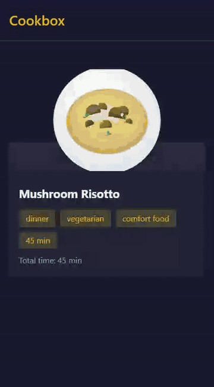
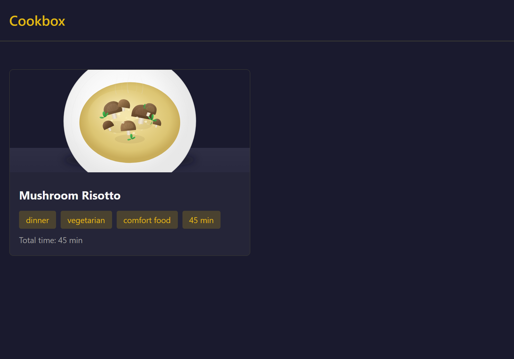
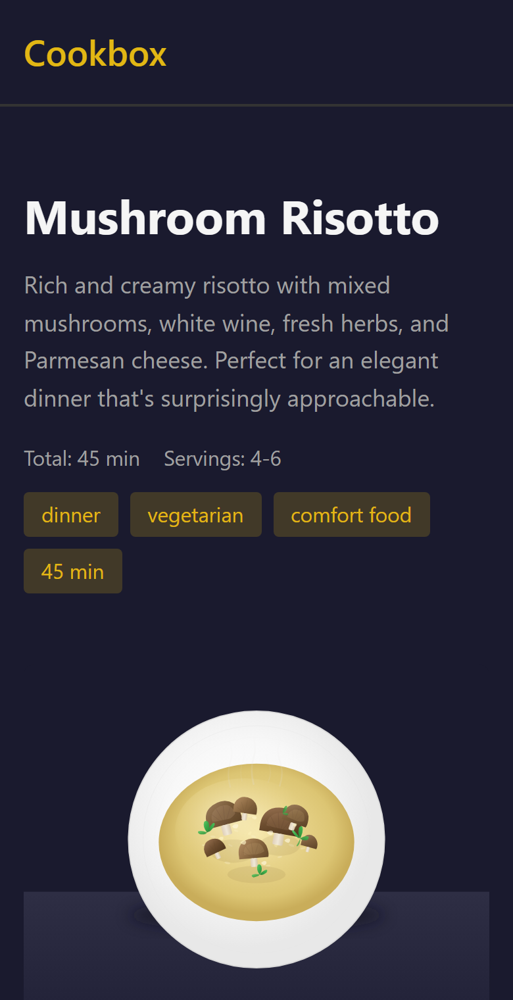
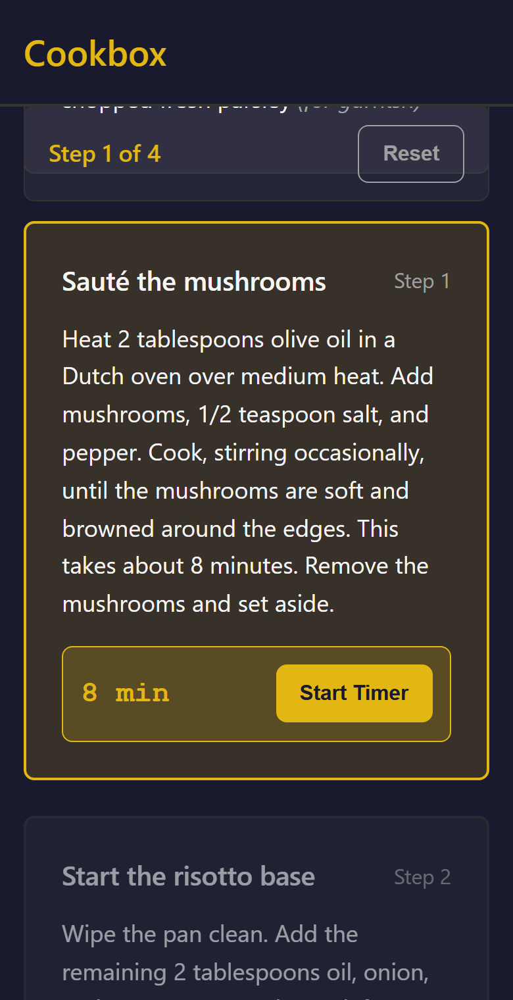

<div align="center">

# Cookbox

### one step · one timer · zero panic



_A recipe app for people whose brain has seventeen tabs open and one of them is the stove._

[](#tech-stack)
[](#run-it)
[](#features)

**[Live demo](https://cookbox-pwa.netlify.app)**

</div>

---

## What is this?

Most recipe sites are a 3,000-word memoir about a grandmother's trip to Tuscany, nine ads, a pop-up, and then, somewhere near the bottom, "sauté the mushrooms."

Cookbox is the opposite. It shows you **one step at a time**, gives that step **a big, obvious timer**, and keeps a **progress bar** at the top so you always know how far in you are. The current step is lit up in warm yellow. Everything else fades politely into the background.

It's designed with ADHD in mind: low cognitive load, nothing to hunt for, no wall of text, no ads. It works just as well if you're simply tired, hungry, and holding a wooden spoon.

<p align="center">
  
  
  
</p>

---

## Features

- **Step-by-step cooking.** One step is "current"; finished steps dim, upcoming ones wait their turn.
- **Multiple timers.** Rice, mushrooms and a pan of something forgotten can all be counting down at once.
- **Progress tracking.** "Step 2 of 4" is always on screen, and it's saved, so a page refresh won't make you start over.
- **Tick-off ingredients.** Tap an ingredient to cross it off while you gather everything.
- **Keyboard friendly.** Arrow up and down move between steps, no greasy screen-touching required.
- **Calm, dark interface.** Big type, high contrast, and no motion for motion's sake.
- **Offline support.** Install it once and it works in a kitchen with terrible Wi-Fi (which is every kitchen).
- **Installable PWA.** Add it to your phone's home screen like a real app.

---

## Run it

There is no build step. It's HTML, CSS and a few JavaScript files.

```bash
npm install        # only needed for the linting / test tooling
npm run dev        # serves the folder with `npx serve .`
```

Open the URL it prints and pick a recipe.

```bash
npm run lint           # ESLint
npm run format:check   # Prettier
npm run test:e2e       # Playwright (Chromium, Firefox, WebKit) incl. visual snapshots
```

---

## Adding a recipe

Recipes are plain JSON in [`recipes/`](recipes/). Add a file, list its id in [`recipes/index.json`](recipes/index.json), and it appears in the app.

```json
{
    "id": "mushroom-risotto",
    "title": "Mushroom Risotto",
    "prepTime": 15,
    "cookTime": 30,
    "servings": "4-6",
    "tags": ["dinner", "vegetarian"],
    "ingredients": [{ "amount": "1.5 cups", "item": "Arborio rice", "note": "rinsed" }],
    "steps": [
        { "title": "Sauté the mushrooms", "body": "…", "time": "8 min" },
        {
            "title": "Start the base",
            "body": "…",
            "timers": [{ "label": "Soften onion", "time": "6 min" }]
        }
    ]
}
```

See [`recipes/mushroom-risotto.json`](recipes/mushroom-risotto.json) for a complete example. A step with a `time` gets a big "Start Timer" button, a step with several `timers` gets one per task, and a step with neither just gets out of your way.

---

## Tech stack

- Vanilla JavaScript modules (`js/`), no framework and no bundler
- Plain CSS (`css/`)
- Service worker (`sw.js`) and web manifest for offline and install
- Recipes as structured JSON data
- ESLint, Prettier, Husky and Playwright for guard rails
- Deployed as a static site on Netlify

---

## A short history

Cookbox started on **14 February 2026** with a requirements interview ([`INTERVIEW.md`](INTERVIEW.md)) and an implementation plan, followed by guard rails (lint, format, hooks, visual tests) before any real features. After that, the project was built largely by an autonomous "Ralph Wiggum" loop: fresh-context AI iterations, each picking up the next task from [`IMPLEMENTATION_PLAN.md`](IMPLEMENTATION_PLAN.md), writing code, and committing. Over 60 commits later, you can boil a risotto with it. The specs it worked from live in [`specs/`](specs/).

---

## License

[MIT](LICENSE)
